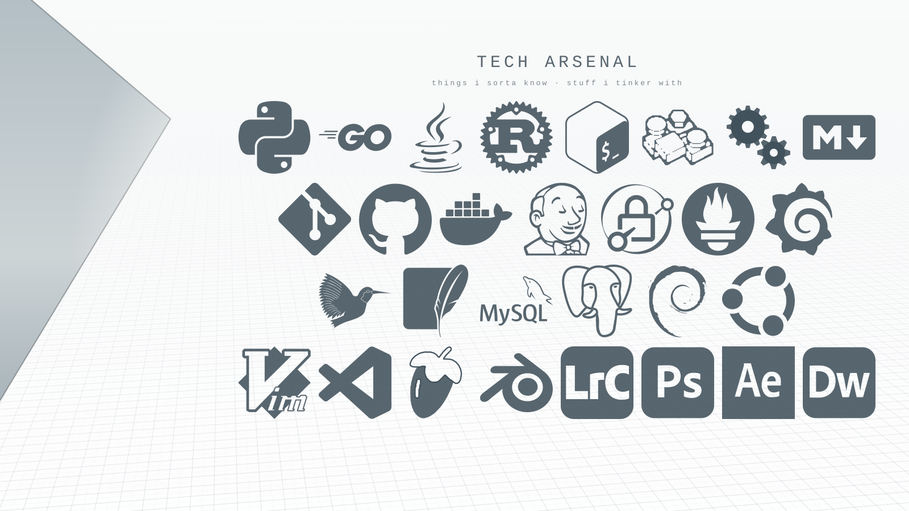

  <h1><b>- Oh, Hey! It's ZnLuAr -</b></h1>
  
<em>... A wild backend developer appeared ...!</em>

  
Backend dev still lvling up · Student always bewildered · Beginner eager to learn it all

   
  
English · <a href="README.zh-CN.md">简体中文</a>

---

<h2><samp>About Me</samp></h2>

  <samp>
    ... A student currently learning backend development 🤔
  </samp>

  <samp>
    Well... I’m still at the beginning of my journey. For now, I’m focused on building a solid foundation and experimenting with projects — some small, others perhaps a little more ambitious.
  </samp>

  <samp>
    <em>
      But hey, that’s how it starts, isn't it? I’m just <b>building</b> things, <b>breaking</b> things, and... hopefully <b>learning</b> something along the way. 
    </em>
  😋
  </samp>

 
 

  <picture>
    <source media="(prefers-color-scheme: dark) and (prefers-reduced-motion: no-preference)" srcset="assets/hero/hero-dark-motion.svg">
    <source media="(prefers-color-scheme: light) and (prefers-reduced-motion: no-preference)" srcset="assets/hero/hero-light-motion.svg">
    <source media="(prefers-color-scheme: dark)" srcset="assets/hero/hero-dark.svg">
    <source media="(prefers-color-scheme: light)" srcset="assets/hero/hero-light.svg">
    
  </picture>

  <em>—— Some icons by <a href="https://icons8.com">Icons8</a></em>

---

<h2><samp>Now</samp>...</h2>

<ul>

  <li><samp>
    <b>Architecture</b> — Learning to trace dependencies through complex projects and systems, turning ideas about good design into practical judgment.
    <s>Doing some ctrl+clicks...</s>
  </samp></li>

  <li><samp>
    <b>Toolkit</b> — Turning unfamiliar names like Ansible, NATS JetStream... into hands-on experience through real work.
  </samp></li>

  <li><samp>
    <b>Projects</b> — Maintaining personal or team projects, and turning new ideas into features along the way...
  </samp></li>

  <li><samp>
    <b>Side quests</b> — Taking a few cautious, curiosity-driven steps into ops and frontend dev. 
    <s>Hand-editing some HTML...</s>
  </samp></li>

  <li><samp>
    <b>Beyond code</b> — Learning to work with people, and to handle the things that never show up in a diff.
  </samp></li>

</ul>

<samp><em>
  Feeling my way forward—in code and beyond ... trying to become a better version of myself, and <b>to catch up with everyone around me</b>.
</em></samp>

Updated 2026-11

 

---

  <h2><samp>❤️ Glad You Stopped By...</samp></h2>
  
<samp>Feeling a bit happier now? Hope I can bring you a little more joy!</samp>

  <em>
    <samp>If you'd like to say hi, or build something together — come play with me!</samp>
  </em>

 

---

  <em>...Oh dear mom why is software engineering so hard (sob)</em>

