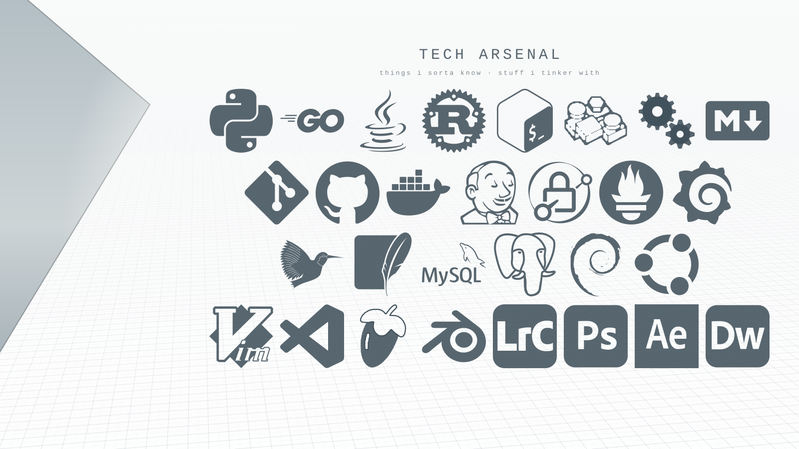

  <h1><b>- 哦，嘿！这里是 ZnLuAr。-</b></h1>
  
<em>…… 一只野生的后端出现了 ……！</em>

  
仍在升级的后端 · 脑子宕机的学生 · 什么都想学的新手

   
  
<a href="README.md">English</a> · 简体中文

---

<h2><samp>关于我</samp></h2>

  <samp>
    ……正在学习后端开发的学生一名 🤔
  </samp>

 

  <samp>
    应该说……仍处在计算机旅程的起点。目前主要是在夯实基础，并且尝试做一些项目以积累实操经验。这些项目有些很小，有些或许稍微有了那么一点点野心。
  </samp>

 

  <samp>
    <em>
      然后嘛，要说到开始的话，一般不都是这样的吗……？差不多就是<b>写出点代码</b>、再<b>搞坏些东西</b>，还有……要是在这一路上能<b>学到</b>些什么东西，那就再好不过了……
    </em>
  😋
  </samp>

 
 

  <picture>
    <source media="(prefers-color-scheme: dark) and (prefers-reduced-motion: no-preference)" srcset="assets/hero/hero-dark-motion.svg">
    <source media="(prefers-color-scheme: light) and (prefers-reduced-motion: no-preference)" srcset="assets/hero/hero-light-motion.svg">
    <source media="(prefers-color-scheme: dark)" srcset="assets/hero/hero-dark.svg">
    <source media="(prefers-color-scheme: light)" srcset="assets/hero/hero-light.svg">
    
  </picture>

  <em>—— 部分图标来自 <a href="https://icons8.com">Icons8</a></em>

<h2><samp>最近</samp></h2>

<ul>

  <li><samp>
    <b>架构</b> —— 差不多是通过真实项目，练习梳理出复杂系统与链条中依赖关系的能力，以及把对好设计的认识与直觉慢慢沉淀成稳定的工程判断。
    <s>进行一个 ctrl+点击……</s>
  </samp></li>

  <li><samp>
    <b>工具箱</b> —— 通过实际项目的开发与维护，让 Ansible、NATS JetStream 等等，从陌生的名词，变成亲手用过的，或在知识储备中随时准备派上用场的工具。
  </samp></li>

  <li><samp>
    <b>项目</b> —— 日常地维护个人项目和团队项目，在其间把冒出来的想法，构建成能用而尽可能优雅的实现……
  </samp></li>

  <li><samp>
    <b>支线</b> —— 跟随着兴趣，向运维和前端的领域，小心翼翼地探几步。 
    <s>手改一些 HTML……</s>
  </samp></li>

  <li><samp>
    <b>代码以外</b> —— 大概是学着怎么和他人一起工作……也在学着处理那些不会出现在 diff 里的问题。
  </samp></li>

</ul>

<samp><em>
  ……就像这样，在计算机与阅历的路上继续前行…… 要是能成为更好的自己就好了；要是再能<b>赶上身边大家的步伐</b>，那就更好了……
</em></samp>

更新于 2026-11

---

  <h2><samp>❤️ 很高兴你能停留……</samp></h2>
  
<samp>有感到更开心一点点了吗？希望我能给你带来快乐！</samp>

  <em>
    <samp>如果想打个招呼，或一起做些事情，欢迎来找我玩！</samp>
  </em>

 

---

  <em>...噢我亲爱的母亲这软件工程怎么这么难💦（抽泣）</em>

